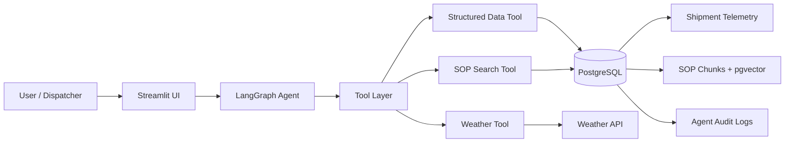
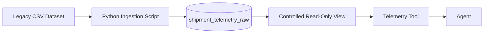
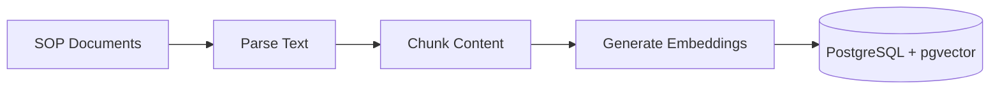
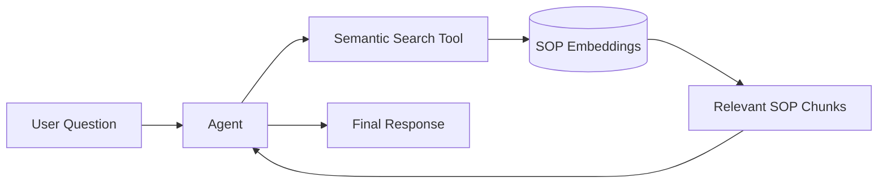
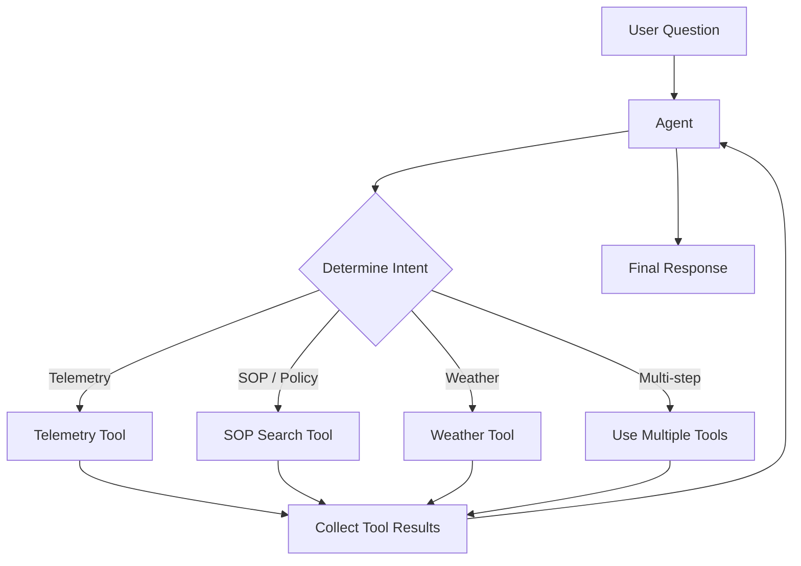
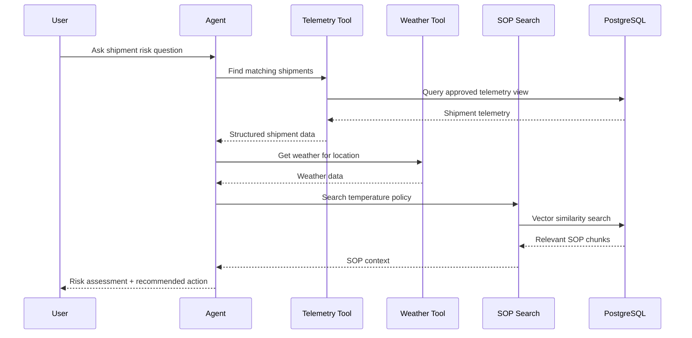
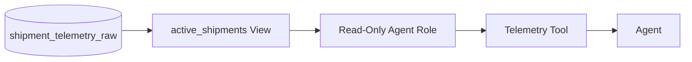
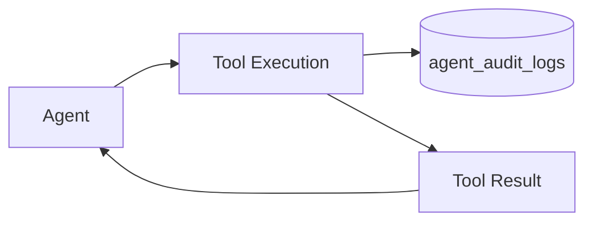
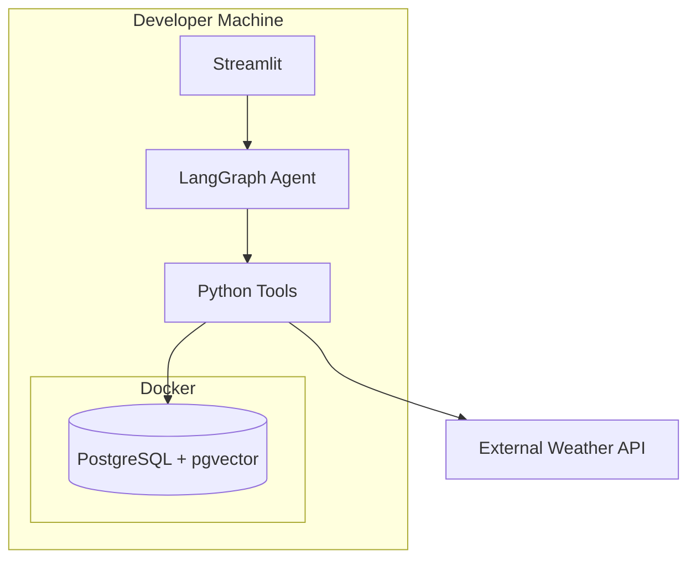
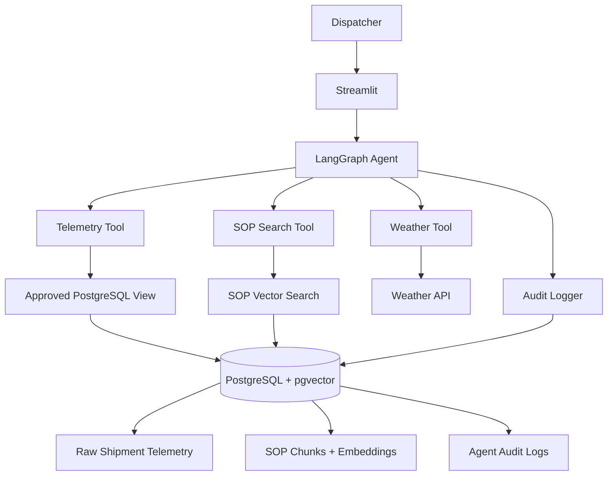

# Architecture

## 1. System Architecture

### 1.1 Overview

The Cold Chain Logistics AI Assistant is a small enterprise-style system that lets operators query:

- shipment and fleet telemetry
- cold-chain SOP knowledge
- external weather conditions

through a natural-language interface.

The system is split into three main layers:

1. **Presentation** — Streamlit UI
2. **Orchestration** — LangGraph agent and tools
3. **Data & Integration** — PostgreSQL + pgvector and external APIs

The agent does not directly access raw application data. Structured data is exposed through controlled database views and read-only access, while SOP knowledge is retrieved through semantic search.

### 1.2 High-Level Architecture



### 1.3 Component Responsibilities

#### Presentation Layer

The Streamlit application is responsible for:

- accepting user questions
- displaying responses
- maintaining lightweight UI session state
- showing relevant operational information

Business logic and reasoning should not live in the UI.

#### Orchestration Layer

The LangGraph agent acts as the orchestration layer.

Its responsibilities include:

- understanding user intent
- deciding which tools are required
- performing multi-step reasoning
- combining tool results
- generating the final response

The agent should operate only through explicitly defined tools.

#### Data & Integration Layer

The data layer contains:

- PostgreSQL for structured telemetry
- pgvector for SOP embeddings
- controlled SQL views for agent access
- audit logging
- external integrations such as weather APIs

PostgreSQL is used for both relational data and vector search to keep the local architecture simple.

---

## 2. Data Architecture

The project uses two types of data.

### 2.1 Structured Operational Data

Shipment telemetry is stored in PostgreSQL.

The raw ingestion table is:

```text
shipment_telemetry_raw
```

It contains fields such as:

- timestamp
- latitude
- longitude
- IoT temperature
- cargo condition
- risk classification
- delay probability
- congestion level
- route risk

The raw table represents the source system and should not be queried directly by the agent.



### 2.2 Unstructured SOP Knowledge

Operational SOP documents are handled using a RAG pipeline.

The ingestion process will:

1. read supported documents
2. extract their text
3. split the text into chunks
4. generate embeddings
5. store the chunks and embeddings in PostgreSQL using pgvector



At query time:



The initial supported source is the Cold Chain Incident SOP.

Additional document types may be supported later if required.

---

## 3. Agent Orchestration

### 3.1 Execution Flow

The agent follows a tool-based execution model.



Typical execution:

1. **Input** — receive a natural-language question.
2. **Intent detection** — determine whether telemetry, SOP, weather, or multiple sources are needed.
3. **Tool execution** — invoke only the required tools.
4. **Result collection** — gather structured results from tools.
5. **Synthesis** — combine those results into a user-facing answer.

### 3.2 Example Multi-Step Query

Example:

> Find active shipments near Los Angeles, check the local weather, and determine whether the current cargo temperature violates the SOP.



### 3.3 Failure Handling

The agent should fail safely.

Examples:

- If the weather API is unavailable, report that weather data could not be retrieved.
- If no SOP context is found, do not invent a policy.
- If a database query fails, return a controlled error instead of exposing raw stack traces.
- Tool failures should be logged for debugging and auditing.

---

## 4. Data Security

Security should be enforced at the database and tool layers, not only through prompts.

### 4.1 Raw Data Isolation

The agent must not directly access:

```text
shipment_telemetry_raw
```

Instead, it should access a controlled view containing only the data required for operations.

Example future view:

```text
active_shipments
```



### 4.2 Database Permissions

A dedicated PostgreSQL role should be created for the agent.

The agent should be allowed to:

- read approved views
- search approved SOP data
- optionally insert audit events

The agent should not be allowed to:

- insert shipment telemetry
- update shipment telemetry
- delete data
- create or drop tables
- alter the database schema
- access unrelated tables

### 4.3 Why This Matters

Prompt instructions alone are not a security boundary.

Even if an LLM is instructed to avoid destructive operations, database permissions should make destructive actions impossible.

---

## 5. Auditing

Agent activity should eventually be written to an append-only audit table.

Example:

```text
agent_audit_logs
```

Possible fields:

- timestamp
- session ID
- user prompt
- tool invoked
- tool input
- tool output
- final agent decision
- error information



The application may receive insert-only access to this table while remaining read-only for operational data.

---

## 6. Local Development Architecture

The project currently runs entirely on the developer machine.



### Current Infrastructure

- Python managed with `uv`
- PostgreSQL + pgvector running in Docker
- telemetry ingested from the provided CSV dataset
- local development through VS Code
- no EC2 infrastructure required

---

## 7. Future Deployment

Cloud deployment is intentionally out of scope for the initial implementation.

The application should remain portable through environment-based configuration such as:

```text
DATABASE_URL
```

This allows the same application to later move from local PostgreSQL to a managed PostgreSQL provider without major application changes.

A future deployment could separate:

```text
Application
    |
    +-- Streamlit / Agent runtime
    |
    +-- Managed PostgreSQL + pgvector
```

Deployment infrastructure should be designed when public hosting becomes necessary rather than introducing cloud infrastructure during local development.

---

## 8. Current Architecture Summary



The main design principle is:

> The agent reasons over data through controlled tools. It does not receive unrestricted access to raw operational systems.
