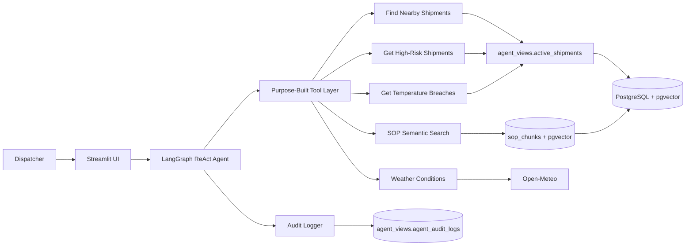
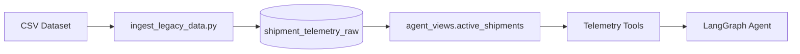
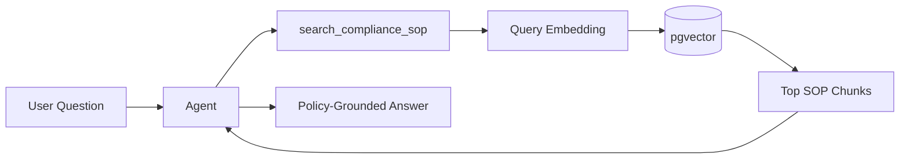
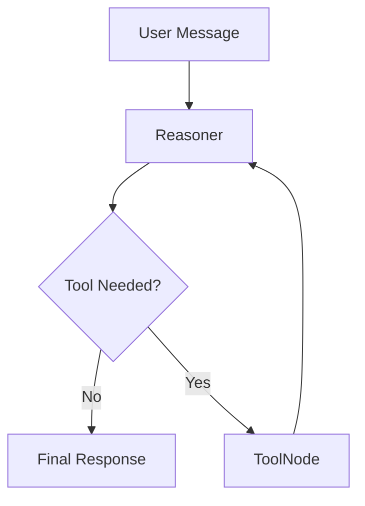
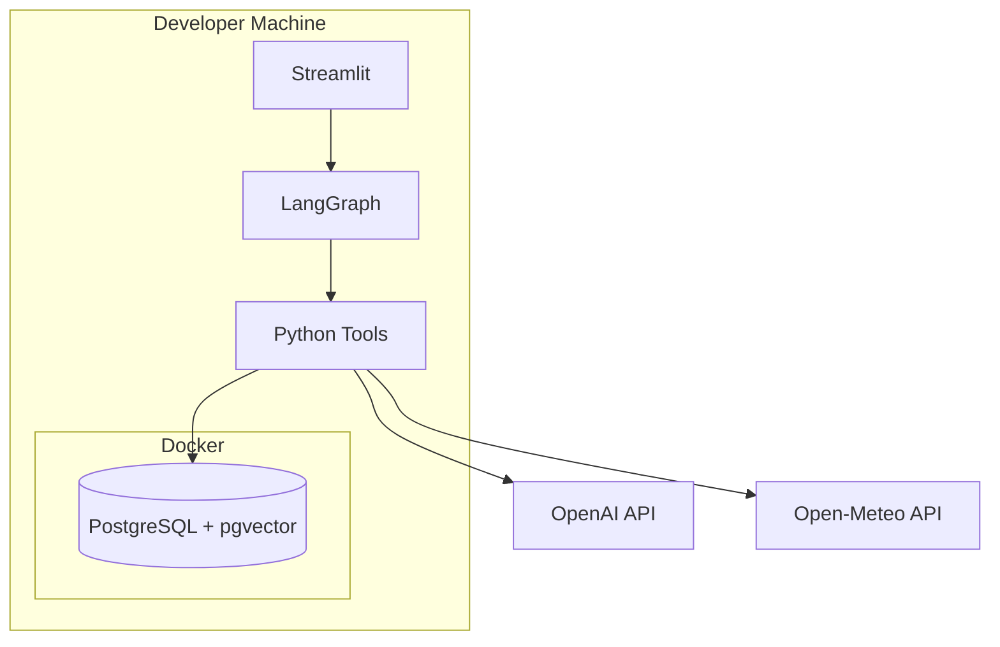

# Architecture

## 1. Overview

The Cold Chain Logistics AI Assistant is an enterprise-style decision-support application for dispatchers.

It combines:

- shipment telemetry;
- cold-chain SOP knowledge;
- live weather data;
- an auditable LangGraph agent;
- a Streamlit operator interface.

Core principle:

> The agent reasons over operational systems through controlled tools. It does not receive unrestricted access to raw data or arbitrary SQL execution.

## 2. High-Level Architecture



## 3. Data Architecture

### 3.1 Structured telemetry

Raw ingestion table:

```text
shipment_telemetry_raw
```

The agent never queries it directly.

Approved semantic view:

```text
agent_views.active_shipments
```



### 3.2 SOP knowledge

Policy documents live in:

```text
data/policy/
```

Ingestion flow:

```mermaid
flowchart LR
    DOC[Policy Documents]
      --> PARSE[Parse by File Type]
      --> CHUNK[Chunk Content]
      --> EMBED[OpenAI text-embedding-3-small]
      --> STORE[(sop_chunks / VECTOR(1536))]
```

Query-time flow:



## 4. Agent Tool Layer

The project avoids arbitrary LLM-generated SQL.

Current tools:

```text
find_shipments_near(...)
get_high_risk_shipments(...)
get_temperature_breaches(...)
search_compliance_sop(...)
fetch_corridor_conditions(...)
```

Telemetry tools execute fixed parameterized SQL.

Benefits:

- smaller attack surface;
- predictable queries;
- easier validation;
- simpler auditing;
- fewer malformed-query failures.

## 5. LangGraph Orchestration



The LLM:

- understands intent;
- chooses required tools;
- combines telemetry, policy, and weather evidence;
- produces an operator-facing response.

The LLM does not:

- write arbitrary SQL;
- change database state;
- invent missing SOP rules.

## 6. Security Model

Two connections are separated:

```text
DATABASE_URL
→ setup / schema / ingestion

AGENT_DATABASE_URL
→ agent runtime
→ cold_chain_agent
```

The runtime role can:

- read `agent_views.active_shipments`;
- read `sop_chunks`;
- insert audit events.

It cannot:

- read `shipment_telemetry_raw`;
- modify telemetry;
- modify SOP data;
- update/delete audit logs;
- create/drop database objects.

## 7. Audit Architecture

Audit table:

```text
agent_views.agent_audit_logs
```

It records:

- user prompts;
- tool calls;
- tool inputs;
- tool results;
- final responses;
- structured failures.

The agent has append-only access.

The Streamlit audit viewer currently uses the privileged database connection and is intended for trusted local/operator use only.

## 8. Error Handling

The system fails safely:

- tool/database failures show controlled user-facing messages;
- raw implementation errors are not exposed in chat;
- failures are audited where possible;
- invalid tool inputs are bounded;
- missing SOP evidence is not replaced with invented policy.

## 9. Streamlit UI

```text
Dispatch Console
├── chat with the agent
├── progressively disclosed tool traces
├── final operational response
└── session reset

Audit Logs
└── local/operator inspection of execution events
```

## 10. Local Runtime



## 11. Deployment Boundary

A deployment target should preserve:

```text
Application runtime
├── Streamlit
├── LangGraph agent
└── Python tool layer

Database
└── PostgreSQL + pgvector
```

Deployment must preserve:

- separate admin and runtime credentials;
- no raw telemetry access for the agent;
- append-only audit writes;
- protected audit-log viewing;
- secrets supplied through environment variables or the hosting platform's secret manager.
