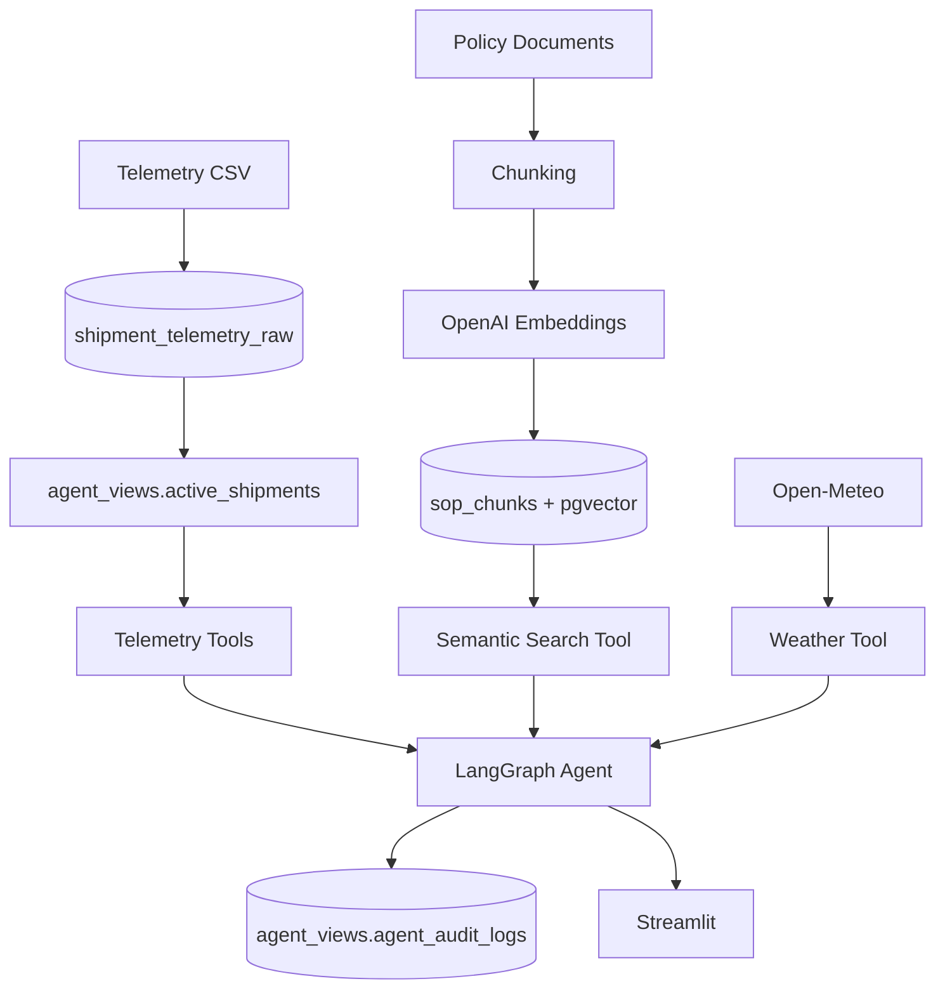

# Data and Retrieval Pipeline

## 1. Structured Telemetry

Dataset:

```text
https://www.kaggle.com/datasets/datasetengineer/logistics-and-supply-chain-dataset
```

Expected file:

```text
data/raw/dynamic_supply_chain_logistics_dataset.csv
```

Ingestion script:

```text
scripts/ingest_legacy_data.py
```

Run:

```bash
uv run python scripts/ingest_legacy_data.py
```

Current result:

```text
32065 rows loaded
```

Raw table:

```text
shipment_telemetry_raw
```

Legacy-style columns include:

```text
TS_UTC
V_LAT
V_LON
IOT_TEMP_VAL_C
CGO_COND_CD
RISK_CLS_TXT
DELAY_PROB_DEC
PRT_CNG_LVL
RT_RSK_IDX
```

## 2. Semantic Operational View

The agent reads:

```text
agent_views.active_shipments
```

This maps legacy fields into semantic names:

```text
timestamp
latitude
longitude
current_temperature_c
cargo_condition
risk_classification
delay_probability
port_congestion_level
route_risk_index
```

Flow:

```text
Raw legacy table
      ↓
Controlled semantic view
      ↓
Purpose-built telemetry tools
      ↓
LangGraph agent
```

## 3. SOP Knowledge Base

Policy documents live in:

```text
data/policy/
```

Current policy set:

- `cold_chain_incident_sop.md`
- `shipment_delay_escalation.md`
- `route_risk_response.md`
- `cargo_condition_handling.md`

The original incident SOP preserves the source-project rules.

The additional policy documents are synthetic project documents used to exercise multi-document retrieval.

## 4. SOP Schema

Vector table:

```text
sop_chunks
```

Core shape:

```sql
CREATE TABLE sop_chunks (
    id BIGSERIAL PRIMARY KEY,
    source_file TEXT NOT NULL,
    file_format TEXT NOT NULL,
    chunk_index INTEGER NOT NULL,
    content TEXT NOT NULL,
    metadata JSONB NOT NULL DEFAULT '{}'::jsonb,
    file_hash TEXT NOT NULL,
    embedding VECTOR(1536) NOT NULL,
    created_at TIMESTAMPTZ NOT NULL DEFAULT NOW(),
    UNIQUE (source_file, chunk_index)
);
```

The project uses an HNSW cosine-distance index.

## 5. SOP Ingestion

Script:

```text
scripts/ingest_sop.py
```

Supported formats:

- Markdown;
- text;
- PDF;
- CSV;
- XLSX.

The script uses:

- Markdown-aware splitting;
- recursive chunking;
- file hashes for incremental ingestion;
- OpenAI embeddings.

Embedding model:

```text
text-embedding-3-small
```

Dimensions:

```text
1536
```

Run:

```bash
uv run python scripts/ingest_sop.py
```

Current policy set produces:

```text
23 chunks
```

## 6. Semantic Search

Verification script:

```text
scripts/search_sop.py
```

Example:

```bash
uv run python scripts/search_sop.py "When should a shipment be escalated to Tier 2?"
```

Flow:

```text
Question
  ↓
OpenAI embedding
  ↓
1536-dimensional vector
  ↓
pgvector cosine-distance search
  ↓
Top SOP chunks
```

## 7. Agent Data Access

The runtime does not expose a generic SQL tool.

Instead:

```text
find_shipments_near
get_high_risk_shipments
get_temperature_breaches
search_compliance_sop
fetch_corridor_conditions
```

This prevents the LLM from generating arbitrary SQL.

## 8. Database Security

Runtime connection:

```text
AGENT_DATABASE_URL
```

Restricted role:

```text
cold_chain_agent
```

It can:

- read approved telemetry;
- read SOP chunks;
- append audit events.

It cannot:

- access raw telemetry;
- update/delete operational data;
- modify SOP data;
- modify historical audit records.

## 9. Audit Data

Audit table:

```text
agent_views.agent_audit_logs
```

The audit trail records:

- user prompts;
- selected tools;
- tool arguments;
- tool outcomes;
- final responses;
- structured execution errors.

## 10. Final Data Flow



## 11. Current State

The local data layer is complete:

- telemetry ingestion works;
- semantic operational view works;
- policy ingestion works;
- pgvector retrieval works;
- runtime role permissions are enforced;
- audit logging is enabled;
- the LangGraph agent consumes data through controlled tools.
